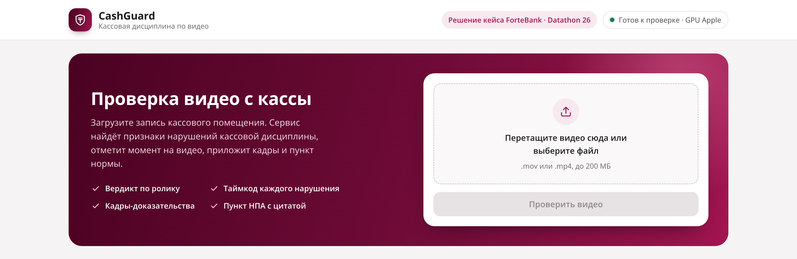
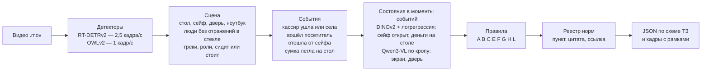
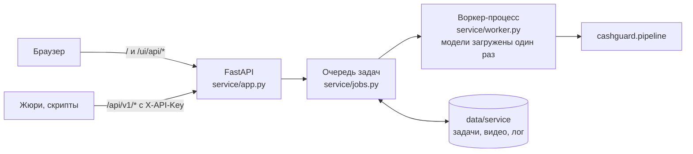

# CashGuard

Сервис, который смотрит видеозапись кассового помещения и находит признаки нарушений кассовой дисциплины.
По каждому найденному нарушению он отдаёт тип, таймкод, 1–3 кадра-доказательства с разметкой, описание
увиденного и пункт нормативного акта РК с дословной цитатой.

Решение кейса ForteBank на хакатоне **Datathon 26**. Все модели работают локально на сервере сервиса,
облачные AI-API не используются.

**Демо:** <https://136-80-9-18.sslip.io/> · **Swagger:** <https://136-80-9-18.sslip.io/docs> ·
**Материалы сдачи:** [docs/submission.md](docs/submission.md)



> Результат — подсказка для проверяющего, а не юридическое или дисциплинарное заключение.
> Сервис описывает только то, что видно в кадре.

## Содержание

- [Что умеет](#что-умеет)
- [Результаты](#результаты)
- [Архитектура](#архитектура)
- [Типы нарушений и нормы](#типы-нарушений-и-нормы)
- [Модели](#модели)
- [Быстрый старт](#быстрый-старт)
- [API](#api)
- [Оценка на датасете](#оценка-на-датасете)
- [Развёртывание](#развёртывание)
- [Структура репозитория](#структура-репозитория)
- [Ограничения](#ограничения)
- [Документация](#документация)
- [Лицензия](#лицензия)

## Что умеет

- **Вердикт по ролику**: «нарушение не обнаружено» или «обнаружены признаки возможных нарушений».
- **Таймкод начала нарушающего действия.** Так размечен обучающий датасет: момент ухода кассира, входа посетителя, посадки.
- **Кадры-доказательства** с рамками: люди и их роли, стол, сейф, дверь, экран, предметы на столе. На рамках видны вероятности классификаторов и ответы VLM.
- **Норма**: пункт НПА из проверенного реестра, дословная цитата и ссылка на абзац в ИПС «Әділет».
  Прямая и косвенная норма различаются в тексте описания.
- **Асинхронный API** с ключом `X-API-Key` по схеме ТЗ и **веб-интерфейс** без авторизации. Под видео
  в интерфейсе показаны дорожки фактов, на которых построен вывод: сколько людей в помещении, открыт ли сейф,
  есть ли деньги или сумка на столе, кто входил и уходил.

## Результаты

Обучающий датасет: 40 уникальных роликов (дубликаты по md5 объединены), 21 с нарушением и 19 без.

| Вариант | Найдено нарушений | Ложных срабатываний | Accuracy вердикта |
|---|---|---|---|
| Развёрнутый сервис, сквозной прогон через API | **15 из 21** | **0 из 19** | **0,85** |
| Офлайн, классификаторы проверены на невиданном ракурсе (LOSO) | 14 из 21 | 0 | 0,825 |
| Синтетический поворот камеры | 11 из 21 | 0 | 0,750 |
| Синтетическое зеркало (камера с другой стороны) | 13 из 21 | 0 | 0,800 |
| Начальный прототип: только детекторы и правила | 8 из 21 | 0 | 0,675 |
| Zero-shot VLM на всех состояниях (подход отвергнут) | 8 из 21 | 3 | 0,600 |

- Тип нарушения верен в 14 из 14 найденных случаев с уверенной ручной разметкой.
- Таймкод попадает в ±2 с у 13 из 16 событий.
- Сквозной прогон шёл на Google Cloud (NVIDIA L4): обработаны 40 из 40 роликов, ошибок схемы нет.
- Время от отправки до результата вместе с загрузкой видео: медиана 15 с, максимум 63 с при лимите ТЗ 300 с.
- Отдельно проверена локальность: с закрытым исходящим интернетом сервер выдал тот же результат.

Разбор каждого пропуска — в [docs/submission.md](docs/submission.md#8-ограничения-и-известные-ошибки).

## Архитектура

### Конвейер анализа



1. **Детекторы.** RT-DETRv2 находит людей, ноутбук, стаканы и сумки. OWLv2 по текстовым запросам ищет стол, дверь, сейф, деньги, инкассаторскую сумку и одежду.
2. **Сцена** (`cashguard/scene.py`). Положение стола, сейфа, двери и ноутбука определяется автоматически по всему ролику. Отражения в стекле и люди за стеклянной стеной отсекаются по росту фигуры, уровню стола и «двойнику» реального человека. Свой трекер связывает людей между кадрами. Кассиром считается самый долгий трек и его продолжения, остальные люди — посетители.
3. **События.** Кассир ушла, вошёл посетитель, кассир вошла в пустую кассу и села, отошла от сейфа, сумка легла на стол, стакан поднесён к лицу. Таймкод нарушения берётся из события, поэтому он точный.
4. **Состояния** проверяются только в моменты событий:
   - обученные классификаторы отвечают, открыт ли сейф и лежат ли деньги на столе;
   - локальная VLM получает 0–5 вопросов на ролик по кропу экрана или двери.
5. **Правила** (`cashguard/rules.py`) складывают события и состояния в нарушение. Затем реестр (`cashguard/registry.py`, `cashguard/norms.py`) подставляет описание и норму.

**Почему не «VLM смотрит всё видео».** Zero-shot VLM на вопросах «да/нет» о состояниях дала 0 новых находок и 3 ложных срабатывания. Поэтому VLM используется точечно, только там, где она надёжна. Конвейер на событиях даёт точный таймкод, укладывается в лимит по времени и объясним: каждое нарушение складывается из наблюдаемых фактов, а не из свободного текста модели.

### Сервис



- Один процесс uvicorn, внутри него очередь и один воркер-процесс с моделями. Задачи обрабатываются строго по порядку.
- Состояние задач хранится на диске. После перезапуска незавершённые задачи снова встают в очередь.
- Упавший воркер поднимается заново, задача повторяется один раз.
- Видео, загруженные через API, удаляются после обработки.
- Кэш признаков (`data/cache/<job_id>.json`) позволяет пересчитать правила без моделей.

## Типы нарушений и нормы

| Код | Нарушение | Как определяется | Норма |
|---|---|---|---|
| A | Ценности оставлены без присмотра | помещение опустело, на столе деньги или инкассаторская сумка | Правила № 231, п. 20 ч. 2; п. 22 |
| B | Сейф оставлен открытым | кассир отошла от сейфа, классификатор: дверца открыта | Правила № 231, п. 20 ч. 2, п. 80 (косвенно) |
| C | Наличные прошлой операции открыто на столе | вошёл следующий посетитель, деньги на столе | Правила № 231, п. 20 ч. 2 |
| E | Посторонний в кассовом помещении | три человека и больше или посетитель на стороне кассира | Правила № 14, п. 8, п. 16 пп. 1; Правила № 231, п. 14, 17 (косвенно) |
| F | Приём инкассаторской сумки без проверки | сумка легла на стол, принёсший ушёл в пределах 6 с | Правила № 231, п. 24 пп. 3–4, п. 25 |
| G | Личные вещи или напитки на рабочем месте | сумка или одежда на столе ≥ 2 с; кассир пьёт при деньгах | Правила № 231, п. 12 |
| H | Дверь кассового помещения не закрыта | кассир вошла и села, VLM: дверь открыта в 2 кадрах из 3 | Правила № 14, п. 8, п. 16 пп. 1 (косвенно) |
| L | Компьютер не заблокирован при уходе | помещение опустело, VLM: на экране рабочая программа | Требования АРРФР № 53, п. 26 пп. 1, п. 71 пп. 9 (косвенно) |

В реестре описаны, но не включены, потому что сигнал по видео ненадёжен:

- **D** — приём наличных без проверки на детекторе;
- **I** — приём без предъявления документа;
- **J** — пересчёт не в присутствии клиента.

Источники, сверенные дословно с ИПС «Әділет» ([реестр](docs/npa_registry.md)):

- Правила осуществления кассовых операций, пост. НБРК от 29.11.2019 № 231 — [V1900019680](https://adilet.zan.kz/rus/docs/V1900019680);
- Правила организации охраны и устройства помещений банков, пост. НБРК от 24.02.2020 № 14 — [V2000020075](https://adilet.zan.kz/rus/docs/V2000020075);
- Требования к обеспечению информационной безопасности банков, пост. АРРФР от 03.04.2026 № 53 — [V2600038336](https://adilet.zan.kz/rus/docs/V2600038336).

Ссылки вне реестра сервис не выдаёт.

## Модели

| Модель | Роль | Лицензия |
|---|---|---|
| [RT-DETRv2 R50](https://huggingface.co/PekingU/rtdetr_v2_r50vd) | люди, ноутбук, стаканы, сумки | Apache-2.0 |
| [OWLv2 base](https://huggingface.co/google/owlv2-base-patch16-ensemble) | стол, дверь, сейф, деньги, сумки, одежда по текстовым запросам | Apache-2.0 |
| [DINOv2 base](https://huggingface.co/facebook/dinov2-base) | признаки для классификаторов состояний | Apache-2.0 |
| [Qwen3-VL-4B-Instruct](https://huggingface.co/Qwen/Qwen3-VL-4B-Instruct) | вопросы по кропу экрана и двери, предразметка денег | Apache-2.0 |
| Логистическая регрессия, scikit-learn | «сейф открыт» и «деньги на столе», `models/*.joblib` | обучена командой |

**Дообучение.** Оба классификатора обучены поверх замороженного DINOv2.

- **Сейф** (`scripts/train_safe.py`):
  - ручная разметка интервалов открытия — [labels/safe_state.csv](labels/safe_state.csv);
  - перед эмбеддингом люди на кадре закрашиваются, иначе модель учит «человек у сейфа», а не «дверца открыта».
- **Деньги на столе** (`scripts/train_money.py`):
  - кроп стола делится на плитки 4×2;
  - разметка — предразметка через grounding VLM, проверенная вручную.
- **Оценка:** отложенный ролик (LOVO), отложенный ракурс (LOSO, 9 групп) и синтетические ракурсы (`scripts/make_aug.py`).

Подходящих открытых датасетов со сценой «касса банка сверху» не нашлось; разбор с лицензиями — в [docs/open_datasets.md](docs/open_datasets.md).

## Быстрый старт

Нужны Python 3.12 и [uv](https://docs.astral.sh/uv/). Проверено на Apple M4 Max (MPS) и NVIDIA L4 (CUDA). Для VLM нужно около 9 ГБ памяти.

```bash
git clone https://github.com/AliNurym/cashguard-datathon26.git
cd cashguard-datathon26
uv venv --python 3.12 .venv
uv pip install --python .venv/bin/python -r requirements-service.txt
.venv/bin/python scripts/download_models.py
```

Последняя команда один раз скачивает веса четырёх моделей, около 9 ГБ. Дальше сервис работает без интернета.

Запуск: один процесс, без `--workers` и `--reload`.

```bash
export KEY=$(openssl rand -hex 16)
CASHGUARD_API_KEY=$KEY .venv/bin/uvicorn service.app:app --host 0.0.0.0 --port 8000
```

Интерфейс откроется на <http://localhost:8000/>. Готовность сервиса — `GET /api/v1/health` с ответом `"worker": "ready"`.
Модели загружаются 10–15 с после старта.

Переменные окружения описаны в [docs/service.md](docs/service.md#переменные-окружения). Например, при
`CASHGUARD_VLM=0` сервис не загружает VLM: правила L и H молчат, остальные работают.

## API

```bash
curl -X POST http://localhost:8000/api/v1/analyze -H "X-API-Key: $KEY" -F "file=@video.mov"
# {"job_id": "16afab6eee57"}

curl http://localhost:8000/api/v1/jobs/16afab6eee57 -H "X-API-Key: $KEY"
```

```json
{
  "job_id": "16afab6eee57",
  "status": "done",
  "verdict": "violation",
  "violations": [
    {
      "type": "Ценности оставлены без присмотра",
      "timecode_sec": 15.2,
      "description": "Кассир покидает кассовое помещение (15.2 с), на рабочем столе остаются наличные или сумка с ценностями. Возможное нарушение требования: … № 231, п. 20 ч. 2 …",
      "evidence_frames": [{"timestamp_sec": 15.2, "image_base64": "/9j/4AAQ..."}]
    }
  ]
}
```

- `status` принимает значения `processing`, `done` и `failed`. При `failed` в ответе есть поле `error`.
- Коды ошибок:
  - `401` — нет ключа или ключ неверный;
  - `404` — неизвестная задача;
  - `400` — пустой файл;
  - `413` — файл больше 200 МБ;
  - `422` — в запросе нет поля `file`.
- Полное описание — в [docs/service.md](docs/service.md#3-api-тз-раздел-10).

## Оценка на датасете

Датасет организаторов в репозиторий не входит. Чтобы воспроизвести оценку, положите ролики в
`data/open/videos/`, а разметку — в `data/open/open_labels.xlsx`. Ручные типы нарушений уже лежат
в [labels/types.csv](labels/types.csv).

Сквозная проверка через API запущенного сервиса проверяет время, падения и схему ответа:

```bash
echo "$KEY" > data/service/dev_api_key.txt
.venv/bin/python scripts/api_e2e.py --base http://127.0.0.1:8000 --mode seq
.venv/bin/python scripts/evaluate.py runs/api_seq.json
```

Исследовательский путь — по шагам, с кэшами, чтобы менять правила без повторного прогона моделей:

```bash
.venv/bin/python scripts/extract_features.py                    # детекторы → data/cache
.venv/bin/python scripts/run_vlm.py --qids laptop,door          # ответы VLM для правил L и H → data/vlm_cache
.venv/bin/python scripts/predict.py runs/pred.json --vlm LH     # правила по кэшу
.venv/bin/python scripts/evaluate.py runs/pred.json
```

В этом режиме классификаторы сейфа и денег не подключены. Честная оценка на невиданном ракурсе
(`predict.py --safe-oof LOSO --money-folds`) использует out-of-fold вероятности. Для них нужны:

- синтетические ракурсы — `scripts/make_aug.py`;
- признаки по этим ракурсам — `extract_features.py` с `CASHGUARD_VARIANT`;
- выгрузка вероятностей — `EXPORT_OOF=LOSO scripts/train_safe.py`.

## Развёртывание

Демо развёрнуто на Google Cloud: Compute Engine g2-standard-8 с NVIDIA L4, Caddy с HTTPS через sslip.io,
systemd-юнит, `HF_HUB_OFFLINE=1`.

```bash
sh deploy/make_bundle.sh              # архив кода и классификаторов → dist/
sh deploy/gcp_setup.sh                # на ВМ: драйвер, зависимости, веса, ключ, systemd, Caddy
```

Пошагово — [docs/deploy_gcp.md](docs/deploy_gcp.md). Другие варианты (свой сервер, туннель) — [docs/deploy.md](docs/deploy.md).

## Структура репозитория

```text
cashguard/            конвейер анализа
  detectors.py        RT-DETRv2 и OWLv2
  scene.py            сцена: зоны, люди, отражения, треки, роли
  rules.py            правила A–L, пороги в словаре P
  states.py, embed.py классификаторы сейфа и денег поверх DINOv2
  vlm.py, vlm_plan.py локальная VLM: вопросы по кропу и план вопросов
  registry.py         реестр типов: название, шаблон описания, норма
  norms.py            цитаты и ссылки на пункты из docs/npa_registry.md
  timeline.py         дорожки фактов для интерфейса
  pipeline.py         Analyzer: видео → JSON по схеме ТЗ
service/              FastAPI, очередь, воркер, веб-интерфейс (static/)
scripts/              извлечение признаков, обучение, прогон, оценка, сквозной тест API
labels/               ручная разметка: типы нарушений, интервалы открытого сейфа, ракурсы
models/               обученные классификаторы состояний (*.joblib)
deploy/               сборка архива и установка на ВМ Google Cloud
docs/                 разбор кейса, реестр НПА, сервис, деплой, материалы сдачи
tools/                контактные листы кадров для ручной разметки
```

## Ограничения

- Не найдены 6 нарушений из 21. Среди причин: чёрный лоток не похож на купюры; жест «вставить купюру в детектор» не определяется надёжно; разрешение 464×848 не позволяет однозначно разглядеть отдельные эпизоды.
- Открытый сейф есть только в 3 ракурсах датасета. На новом ракурсе правило B почти не срабатывает, зато и ложных срабатываний не даёт.
- Пороги заданы в долях кадра. При сильной перспективе качество падает, это видно по синтетическому повороту камеры.
- Для B, E, H и L нормы косвенные: это требования к помещению или системе, а не прямой запрет действия кассира. Так и сказано в описаниях.
- Лица не распознаются и не идентифицируются. Кадры-доказательства содержат изображения людей как есть.

Полный список — в [docs/submission.md](docs/submission.md#8-ограничения-и-известные-ошибки).

## Документация

| Документ | О чём |
|---|---|
| [docs/submission.md](docs/submission.md) | материалы сдачи по разделу 8 ТЗ: архитектура, модели, нормы, типы, качество, ограничения |
| [docs/service.md](docs/service.md) | установка, запуск, переменные окружения, API, очередь и хранение |
| [docs/case_analysis.md](docs/case_analysis.md) | разбор кейса, стратегия, разбор пропусков |
| [docs/npa_registry.md](docs/npa_registry.md) | реестр норм: дословные тексты пунктов и ссылки |
| [docs/npa_workstation_lock.md](docs/npa_workstation_lock.md) | обоснование нормы для правила L |
| [docs/open_datasets.md](docs/open_datasets.md) | поиск открытых датасетов и лицензии |
| [docs/deploy_gcp.md](docs/deploy_gcp.md), [docs/deploy.md](docs/deploy.md) | развёртывание |

## Лицензия

- Код распространяется по лицензии [MIT](LICENSE).
- Веса моделей в репозиторий не входят и распространяются по своим лицензиям (Apache-2.0).
- Шрифт Open Sans в `service/static/fonts/` распространяется по SIL OFL 1.1.
- Датасет принадлежит организаторам Datathon 26 и в репозиторий не входит.

Проект — решение кейса на хакатоне и не является продуктом ForteBank. Фирменные цвета в интерфейсе
использованы как оформление решения кейса, логотип банка не используется.
